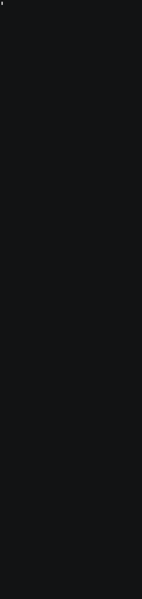

# Demo



Ten queries in two halves. First the real half: bank failures, who controls
the banks, who owns Indian companies, the rupee against the dollar. Then the
generated half: money going round in a circle, payments kept under a reporting
threshold, who paid a customer on a watchlist, and cross-border flows priced at
real rates.

| # | Query | Layer | Question |
|---:|---|---|---|
| 1 | FN16 | both | What is this graph made of? |
| 2 | FN01 | real | US bank failures, year by year |
| 3 | FN02 | real | Which holding companies control the most banks? |
| 4 | FN05 | real | Which countries own the most Indian companies? |
| 5 | FN04 | real | One Indian company, and every parent above it |
| 6 | FN08 | real | The rupee against the dollar, year end to year end |
| 7 | FN09 | generated | Money going round in a circle |
| 8 | FN10 | generated | Payments kept just under the reporting threshold |
| 9 | FN12 | generated | Who paid a customer on the watchlist? |
| 10 | FN13 | both | Cross-border flows, priced at the real exchange rate |

The ten queries in full are in [`queries.cypher`](queries.cypher).

## Run it

```bash
python -m etl.download_data          # once
python -m demo.demo                  # embedded engine, about a minute to load
python -m demo.demo --url http://127.0.0.1:8081 --graph finance
python -m demo.demo --long --url http://127.0.0.1:8081 --graph finance
python -m demo.demo --slides         # one query per screen
python -m demo.demo --no-pause       # no pacing
```

Every number is read from the graph at run time, including the counts on the
title card. Each query carries a tag: `real data`, `generated data`, or `real
and generated together`.

## The recording

Long form: the whole report on one tall screen, in the layout of the case
studies in `samyama-graph/case_studies`.

| File | |
|---|---|
| `finance-kg.gif` | 1105 by 4637 pixels, 56 seconds, 689 KB |
| `finance-kg.cast` | The asciinema recording the GIF was rendered from |
| `record.sh` | Records and renders both |

The finished report is held for 14 seconds before the GIF starts again.

Recorded on 2026-09-30 against the full graph, 69,437 nodes and 149,387 edges,
on a Samyama v1.7.1 server. The closing lines credit the sources and say that
customers, institutions and payments are generated. Keep them in any copy that
is shared.

### Record it again

```bash
demo/record.sh                                   # http://127.0.0.1:8081, graph finance
demo/record.sh http://127.0.0.1:8080 default
GIF_HOLD=20 demo/record.sh                       # a longer hold at the end
```
